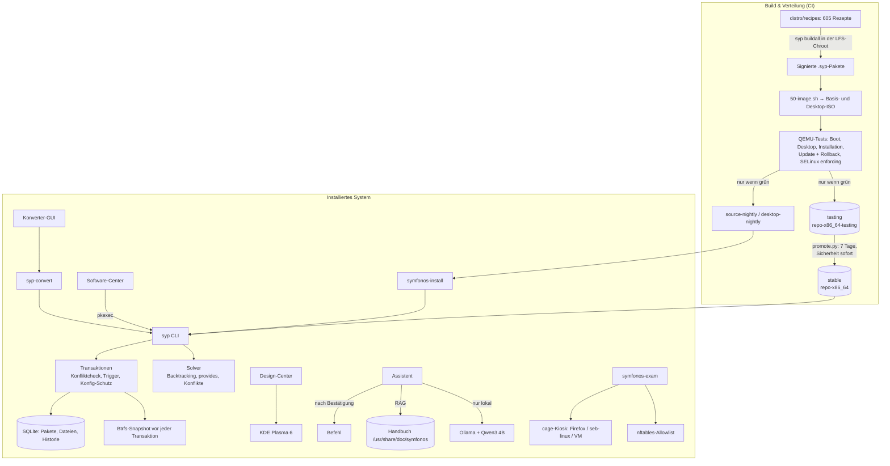
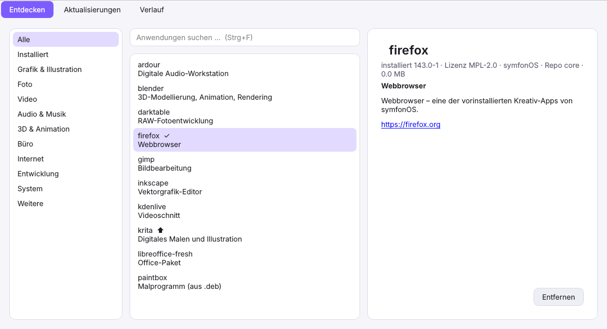
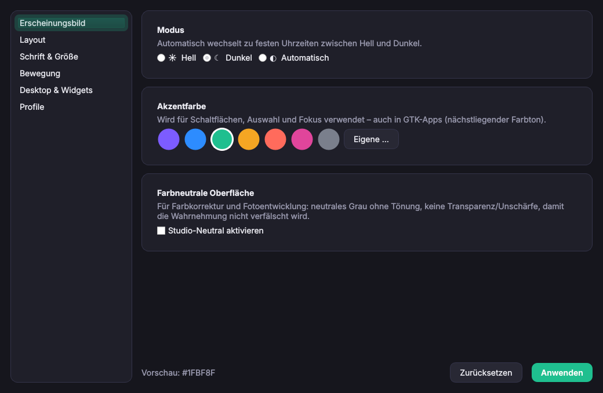
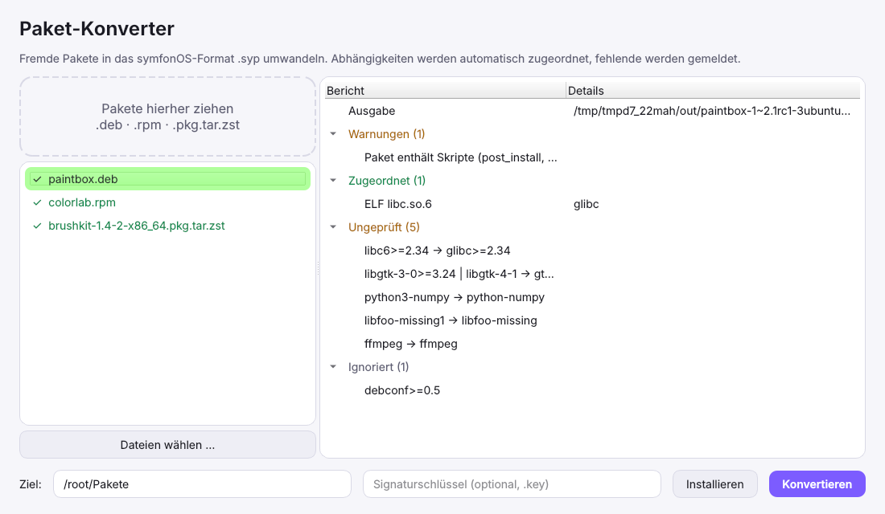

# symfonOS

Eine schlanke, moderne Linux-Distribution für kreative Arbeit: Grafik, Illustration, Foto, Video, Audio und 3D. Sie bringt ein eigenes Paketsystem mit (`syp`), einen Konverter für Fremdpakete, ein zentrales Design-Center, einen lokalen KI-Assistenten und einen Prüfungsmodus.

| | |
|---|---|
| **Basis** | Eigenständige Quellcode-Distribution: eigene Toolchain nach LFS, alle Pakete aus `distro/recipes/` mit `syp buildall` gebaut, keine fremde Distribution darunter |
| **Sicherheit** | SELinux, erzwungene Kernel-Modulsignaturen, KSPP-Härtung, systemweite Krypto-Richtlinien, nftables (eingehend zu), auditd, LUKS2 + TPM2, Secure Boot mit eigenen Schlüsseln und UKI – siehe [SICHERHEIT.md](docs/SICHERHEIT.md) |
| **Qualität** | Kanäle testing → stable mit Wartezeit, CI-Gates (Werror, ASan/UBSan, Härtungsprüfung je Paket), Freigabekriterien – siehe [QUALITAET.md](docs/QUALITAET.md) |
| **Release-Modell** | Rolling Release: die CI baut, testet (Boot, Installation, Update, Rollback) und veröffentlicht ISOs und Pakete nach testing; nach 7 Tagen (Sicherheitsupdates sofort) kommen sie nach stable `repo-x86_64` |
| **Kernel** | eigener Build `linux` (gehärtet, Modulsignaturen erzwungen) |
| **Init** | systemd |
| **Bootloader** | GRUB (oder systemd-boot mit UKI), Live-Medium: systemd-boot/syslinux |
| **Dateisystem** | Btrfs (`@`, `@home`, `@snapshots`, `@var_log`, `@cache`), zstd, syp-Snapshots vor jedem Update (`syp rollback --system`) |
| **Desktop** | KDE Plasma 6 (Wayland), PipeWire/JACK, Inter + JetBrains Mono + Noto |
| **Installer** | `symfonos-install` (Btrfs-Standardlayout, LUKS2 + TPM2, GRUB oder systemd-boot/UKI, SELinux-Relabel) |
| **Paketsystem** | `syp` (Format `.syp`, Ed25519-signiert, SQLite-Datenbank, Rollback) |

## Architektur



## Roadmap

| Phase | Inhalt | Stand |
|---|---|---|
| 0 | Architektur, Basis, Name, Branding | ✅ |
| 1 | Paketsystem `syp`: Format, Signaturen, Repos, Solver, Transaktionen, Trigger, Historie, Rollback, Build-Rezepte | ✅ getestet |
| 2 | `syp-convert` für deb/rpm/arch inkl. ELF-Sonamen-Mapping, CLI + GUI | ✅ getestet |
| 3 | Software-Center, Design-Center, Assistent (RAG, Log-Analyse, Bestätigungspflicht) | ✅ getestet (Offscreen-Screenshots) |
| 4 | Live-ISO und Installer `symfonos-install` (Btrfs/LUKS2/TPM2, GRUB oder UKI) | ✅ Installationstest in CI |
| 5 | Prüfungsmodus (nftables, Kiosk, Dienste/USB), SEB-Varianten | ✅ Trockenlauf getestet |
| 6 | CI/CD: Bau, Tests, Paket-Repo als Release, automatische Updates mit Snapshot und Rollback | ✅ Update- und Rollback-Test im installierten System |
| 7 | Kanäle `testing` → `stable` (`tools/promote.py`: 7 Tage, Sicherheits-Schnellspur, Sperrliste, Abhängigkeitsprüfung) | ✅ in der Bau-CI: Releases `repo-x86_64-testing` → `repo-x86_64` |
| 8 | Kern in C (`syp`, `syp-convert`), Quellcode-Distribution: LFS-Toolchain, 140 Rezepte, `syp buildall` in der Chroot, Live-/Installations-ISO | ✅ ISO `source-nightly`, Boot-Test in QEMU bestanden (Firewall, Audit, SELinux, WLAN-Dienst laufen); Test auf echter Hardware offen |
| 8a | Sicherheit auf Fedora-Niveau: SELinux, Krypto-Richtlinien, PAM, Audit, Firewall, Secure Boot (eigene Schlüssel, UKI), TPM2 | ✅ umgesetzt; SELinux enforcing, kein MS-signierter shim |
| 8b | Desktop aus Quellcode (LLVM, Mesa, Wayland, Qt 6, KDE Plasma 6, SDDM, PipeWire) – siehe [docs/DESKTOP.md](docs/DESKTOP.md) | 🔨 329 Rezepte, CI-Bau läuft; ISO `desktop-nightly` mit grafischem Boot-Test |
| 9 | Delta-Updates, Software-Center mit Screenshots/AppStream, Flatpak-Integration im Store | offen |

## Schnellstart (Entwicklung)

```bash
pip install -e ".[gui,test]"
make -C csrc                           # syp und syp-convert (C11; libarchive, libzstd, libsodium, sqlite3, libcurl)
make test                              # ~95 Tests: Paketsystem, Konverter, Sicherheitsschicht, Kanäle, Prüfungsmodus, Assistent
syp keygen ~/dev --comment test        # Schlüsselpaar
syp build distro/recipes/symfonos-tools/SYPBUILD.toml -k ~/dev.key   # ein Rezept als .syp bauen
syp-convert paket.deb --offline        # Fremdpaket umwandeln
syp -r /tmp/testroot list             # beliebiges Wurzelverzeichnis (Tests, Bootstrap)
# ganze Distribution samt ISO: distro/bootstrap/run-all.sh (siehe .github/workflows/bootstrap.yml)
```

## Verzeichnisse

| Pfad | Inhalt |
|---|---|
| `csrc/` | `syp` und `syp-convert` in C: Format, Signaturen, Solver, Transaktionen, Bau, Härtungsprüfung, Konverter |
| `distro/recipes/` | Rezepte (`SYPBUILD.toml`) der Quellcode-Distribution |
| `distro/bootstrap/` | LFS-Stufen: Cross-Toolchain, temporäre Werkzeuge, Chroot, `syp buildall`, Image |
| `distro/security/` | Sicherheitskonfiguration, `symfonos-security`, `symfonos-secureboot`, Krypto-Richtlinien |
| `distro/installer/` | Installer `symfonos-install` (LUKS2, TPM2, systemd-boot/UKI oder GRUB, SELinux-Relabel) |
| `src/syp_convert` | Konverter-GUI (nutzt das C-Werkzeug) |
| `src/syp_store` | Software-Center |
| `src/symfonos_design` | Design-Center + Plasma-Layouts |
| `src/symfonos_assist` | Lokaler Assistent: RAG, Ollama/llama.cpp, Log-Regeln, Sicherheitslogik |
| `src/symfonos_ui` | Gemeinsamer Qt-Stil (Hell/Dunkel, Akzentfarbe) |
| `system/` | Systemdateien: Units, Polkit, Skripte, Konfiguration |
| `desktop/` | Farbschemata, globale Designs, Logo, SDDM- und KDE-Voreinstellungen |
| `exam/` | Prüfungsmodus |
| `docs/` | [Paketformat](docs/PAKETFORMAT.md), [Sicherheit](docs/SICHERHEIT.md), [Qualität](docs/QUALITAET.md), [Apps & Lizenzen](docs/APPS.md), [SEB](docs/SEB.md), [Risiken & Aufwand](docs/RISIKEN.md), [Handbuch](docs/handbuch/) |

Lizenz: Code GPL-3.0-or-later, Artwork CC-BY-SA-4.0.

## Screenshots

| Software-Center | Design-Center | Paket-Konverter |
|---|---|---|
|  |  |  |
