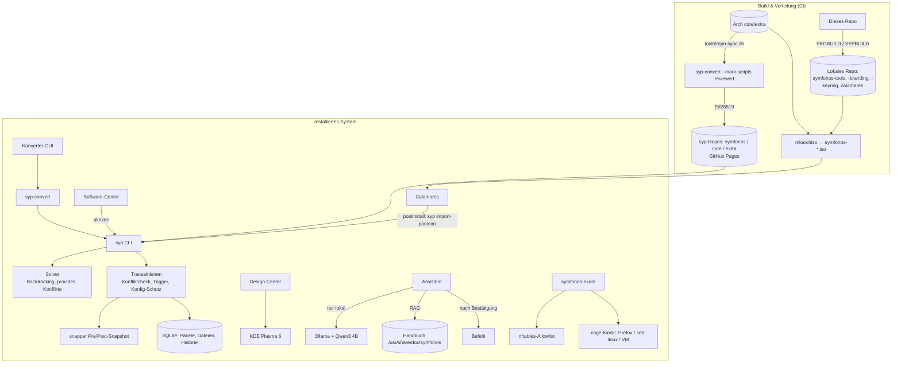
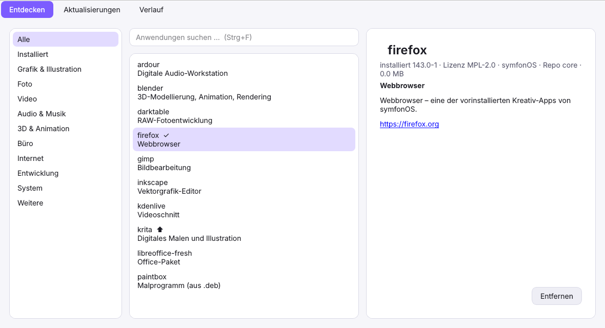
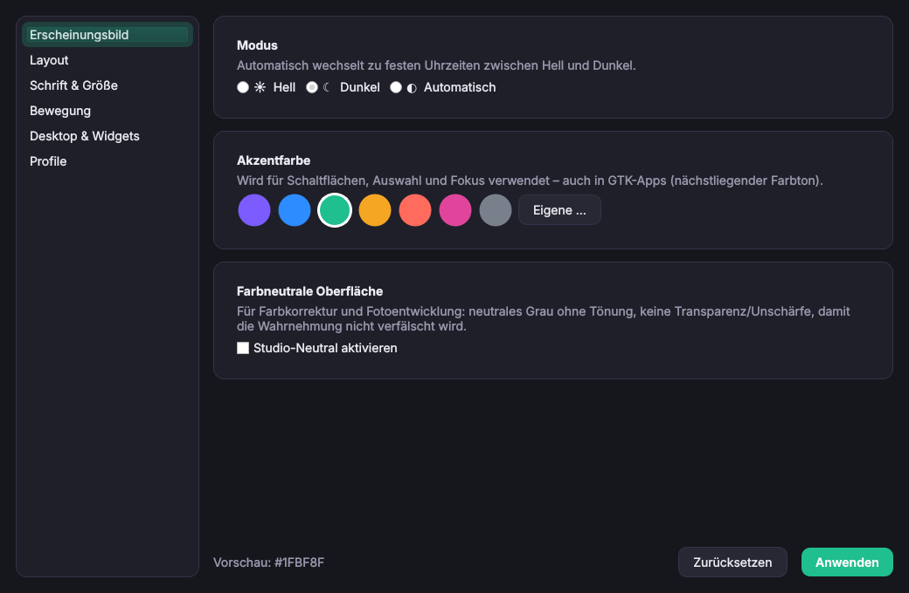
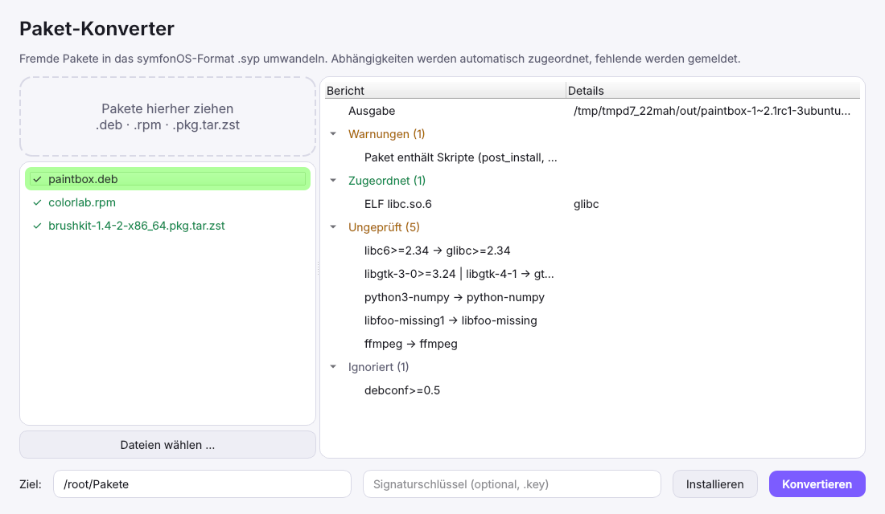

# symfonOS

Eine schlanke, moderne Linux-Distribution für kreative Arbeit: Grafik, Illustration, Foto, Video, Audio und 3D. Sie bringt ein eigenes Paketsystem mit (`syp`), einen Konverter für Fremdpakete, ein zentrales Design-Center, einen lokalen KI-Assistenten und einen Prüfungsmodus.

| | |
|---|---|
| **Basis** | Arch Linux (Binärpakete werden nach `.syp` konvertiert und neu signiert) |
| **Release-Modell** | Rolling Release (nächtlicher Abgleich, Snapshots vor jeder Änderung) |
| **Kernel** | `linux-zen` (niedrige Latenz für Audio/Stift), Fallback `linux-lts` |
| **Init** | systemd |
| **Bootloader** | GRUB + grub-btrfs (Booten in Snapshots), Live-Medium: systemd-boot/syslinux |
| **Dateisystem** | Btrfs (`@`, `@home`, `@snapshots`, `@var_log`, `@cache`, `@ollama`, `@ai_models`), zstd, snapper |
| **Desktop** | KDE Plasma 6 (Wayland), PipeWire/JACK, Inter + JetBrains Mono + Noto |
| **Installer** | Calamares (Btrfs-Standardlayout, optional LUKS) |
| **Paketsystem** | `syp` (Format `.syp`, Ed25519-signiert, SQLite-Datenbank, Rollback) |

## Architektur



## Roadmap

| Phase | Inhalt | Stand |
|---|---|---|
| 0 | Architektur, Basis, Name, Branding | ✅ |
| 1 | Paketsystem `syp`: Format, Signaturen, Repos, Solver, Transaktionen, Trigger, Historie, Rollback, Build-Rezepte | ✅ getestet |
| 2 | `syp-convert` für deb/rpm/arch inkl. ELF-Sonamen-Mapping, CLI + GUI | ✅ getestet |
| 3 | Software-Center, Design-Center, Assistent (RAG, Log-Analyse, Bestätigungspflicht) | ✅ getestet (Offscreen-Screenshots) |
| 4 | ISO: archiso-Profil, Calamares (Btrfs/LUKS/GRUB), Live-Benutzer, Barrierefreiheit beim Boot | ✅ konfiguriert, Bau in CI |
| 5 | Prüfungsmodus (nftables, Kiosk, Dienste/USB), SEB-Varianten | ✅ Trockenlauf getestet |
| 6 | Repo-Spiegel aus Arch, CI/CD, Releases | ✅ Workflow, Secret nötig |
| 7 | Staging-Kanal (`testing` → `stable` nach 7 Tagen + Smoke-Tests in QEMU) | offen |
| 8 | Eigener `filesystem`/`base`-Rebuild, pacman-frei bauen (`syp --root` bootstrap), Secure Boot (shim + MOK) | offen |
| 9 | Delta-Updates, Software-Center mit Screenshots/AppStream, Flatpak-Integration im Store | offen |

## Schnellstart (Entwicklung)

```bash
pip install -e ".[gui,test]"
make test                              # 54 Tests: Solver, Format, Signaturen, Rollback, Konverter, Assistent, Prüfungsmodus
syp keygen ~/dev --comment test        # Schlüsselpaar
syp build SYPBUILD.toml -k ~/dev.key   # symfonos-tools als .syp bauen
syp-convert paket.deb --offline        # Fremdpaket umwandeln
syp -r /tmp/testroot list             # beliebiges Wurzelverzeichnis (Tests, Bootstrap)
sudo ./iso/build.sh out                # ISO bauen (Arch Linux / Container archlinux:latest --privileged)
```

## Verzeichnisse

| Pfad | Inhalt |
|---|---|
| `src/syp` | Paketmanager: Format, Krypto, Solver, Transaktionen, CLI |
| `src/syp_convert` | Konverter (deb, rpm, arch, ELF, Mapping-Tabelle), CLI, GUI |
| `src/syp_store` | Software-Center |
| `src/symfonos_design` | Design-Center + Plasma-Layouts |
| `src/symfonos_assist` | Lokaler Assistent: RAG, Ollama/llama.cpp, Log-Regeln, Sicherheitslogik |
| `src/symfonos_ui` | Gemeinsamer Qt-Stil (Hell/Dunkel, Akzentfarbe) |
| `system/` | Systemdateien: Units, Polkit, Skripte, Konfiguration |
| `desktop/` | Farbschemata, globale Designs, Logo, Calamares-Branding, snapper |
| `iso/` | archiso-Profil inkl. Calamares-Konfiguration |
| `exam/` | Prüfungsmodus |
| `packaging/` | PKGBUILDs (ISO-Bau) |
| `docs/` | [Paketformat](docs/PAKETFORMAT.md), [Apps & Lizenzen](docs/APPS.md), [SEB](docs/SEB.md), [Risiken & Aufwand](docs/RISIKEN.md), [Handbuch](docs/handbuch/) |

Lizenz: Code GPL-3.0-or-later, Artwork CC-BY-SA-4.0.

## Screenshots

| Software-Center | Design-Center | Paket-Konverter |
|---|---|---|
|  |  |  |
